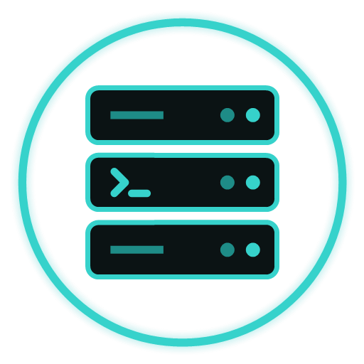

<p align="center">
  
</p>

<h1 align="center">DarkCipher ServerManagement</h1>

<p align="center">
  <b>One encrypted Windows workstation for your servers, network, hypervisors and clouds.</b><br>
  SSH, Remote Desktop and VNC · files · Docker, Proxmox, Hyper-V, vCenter · Vultr, Hetzner, Contabo, Azure, Google Cloud ·
  Markdown docs pinned to your servers · an optional local AI engineer — with every byte it saves encrypted, post-quantum ready.
</p>

<p align="center">
  
  
  
  
  
  
</p>

---

ServerManagement is a local engineering workstation by **DarkCipher Systems**. It replaces a drawer of separate tools —
terminal, RDP manager, SFTP client, hypervisor consoles, cloud dashboards, network toolbox — with one app that keeps
everything it stores in an encrypted store and asks before it changes anything that matters.

> **Public beta.** ServerManagement is built by an IT infrastructure engineer, for engineers. It's free and open source
> (MIT), and more systems are added all the time. It's a beta, and builds aren't code-signed yet (see *Getting it*).
>
> **Testers welcome.** Many integrations are written against the vendors' published APIs but haven't been run against a
> live account yet: Microsoft 365 admin (Intune, Defender, Entra), Windows 365 Cloud PCs, Microsoft Teams, Bitwarden
> (vault and Secrets Manager), UniFi (Network and Site Manager), BeyondTrust PRA, Pingdom, Grafana / SIEM links, Elasticsearch and Loki, Contabo, Hetzner Cloud, Azure, Google Cloud, vCenter,
> Hyper-V, Proxmox, Unraid, Docker, Puppet, WSL and serial consoles. If you use any of them, please tell us whether
> it works.
>
> **Bugs and feature requests:** [report a bug](https://darkciphersystems.com/report.html) or
> [request a feature](https://darkciphersystems.com/feature-requests.html?app=servermanagement) on darkciphersystems.com.

## Highlights

- **Every session in one place.** SSH, embedded Remote Desktop, VNC for Mac and Linux desktops (through SSH by default),
  local PowerShell / cmd / WSL, serial consoles; tabs, split panes, pop-out windows and broadcast input.
- **Infrastructure and cloud.** Docker, Proxmox VE, Unraid, VMware vCenter and Hyper-V; Vultr, Contabo, Hetzner Cloud,
  Microsoft Azure and Google Cloud — read-only until you allow changes, and destructive actions confirm by name.
- **Files.** SFTP with SCP fallback, a two-pane File commander, a verified, resumable transfer queue, a Vim-capable editor.
- **Docs.** A Markdown editor with live preview for runbooks and references, in folders, pinned to hosts, host folders and
  infrastructure (Proxmox clusters, vCenter, Hyper-V, Docker hosts): right-click a host → 📄 Docs.
- **Network & mail toolbox.** Ports and banners, traceroute / mtr, DNS, HTTP / TLS checks, SPF / DMARC / DKIM, blacklists.
- **Automation.** Ansible and Puppet over your saved hosts, dry run first.
- **An AI engineer you control.** Local by default (Ollama, Foundry Local NPU); internet engines are opt-in. It shows
  what it sends, masks secrets, and never runs a command without your approval.
- **Built for organisations.** Group Policy for every setting (ADMX templates), admin-approval (UAC) protection, locks
  for any category or item, Active Directory / LDAPS / Entra sign-in, syslog over TLS and log sinks, a full audit log.
- **Extensible, safely.** Add-ons run sandboxed at Low integrity and talk to the app only over an encrypted bridge with
  the permissions you grant.

## Security

- **Encrypted at rest:** AES-256-GCM under a random 256-bit data key, protected by Windows DPAPI or a master password
  (PBKDF2-SHA256, 600,000 iterations) or Windows Hello. Hosts, credentials, API keys, notes, docs, logs and snapshots —
  everything it writes.
- **Post-quantum ready:** everything saved is AES-256-GCM (quantum-safe) and every key protector is too (Windows Hello
  as a hybrid with a DPAPI secret); SSH prefers the hybrid ML-KEM / NTRU Prime key exchanges OpenSSH 10 uses (and can
  require them); team libraries use ML-KEM-768 and ML-DSA-65 hybrids; updates carry two signatures (ECDSA and ML-DSA)
  and are refused unless both verify. Details: [security report](docs/SECURITY-REPORT.md) §4c.
- **Least surprise:** cloud and infrastructure providers start read-only; PRODUCTION hosts need their name typed for
  disruptive actions; an offline mode blocks everything outside your network.
- **Tested every build:** the self-test (crypto and tamper rejection, crash recovery, every screen, parser fuzzing)
  and a penetration-test suite run before anything is packaged; each release publishes its
  [security report](docs/SECURITY-REPORT.md), an SBOM and SHA-256 checksums.
- **Reporting a vulnerability:** see [SECURITY.md](.github/SECURITY.md).

## Getting it

Download **`DarkCipherServerManagement-<version>-Setup.exe`**: the DarkCipher Systems setup program installs, updates,
repairs or uninstalls in a few clicks and offers the optional extras (desktop shortcut, Nmap, Foundry Local, Ollama).
Each release also ships the **MSI** (per-machine, upgrades in place) for silent and managed deployment (`msiexec`, Group
Policy, Intune), a **portable zip**, Group Policy templates, an SBOM, six PDF guides and this source. Builds are not
code-signed yet, so Windows SmartScreen shows "unknown publisher".

### Build from source

Requirements: Windows 10 1809+ or Windows 11 (x64), the .NET 10 SDK, the WebView2 runtime, and Microsoft Edge for the PDFs.

```powershell
git clone https://github.com/DarkCipher0x/ServerManagement.git
cd ServerManagement
.\build.ps1    # self-test, publish, MSI, portable zip, policy templates, SBOM, PDFs, checksums → dist\<version>\
```

The full procedure is in [docs/BUILD.md](docs/BUILD.md); tests in [docs/TESTING.md](docs/TESTING.md).

## Documentation

Every release ships these as PDFs (complete, user, developer, business, security report, project structure), with its sanitised source:
- Using it: the in-app help (F1), [docs/guide/10-admin.md](docs/guide/10-admin.md) (administration), [docs/guide/40-business.md](docs/guide/40-business.md) (for the organisation: Active Directory / LDAPS / Entra, Group Policy, syslog and log sinks, team, branding, offboarding), [docs/guide/15-ai.md](docs/guide/15-ai.md) (AI), [docs/guide/30-limitations.md](docs/guide/30-limitations.md).
- How it works: [docs/PROJECT-TREE.md](docs/PROJECT-TREE.md) (the tree and how it is built out), [docs/SOURCE.md](docs/SOURCE.md) (every folder and file, the main flows), [docs/ARCHITECTURE.md](docs/ARCHITECTURE.md) (decision records ADR-001 to ADR-077), [docs/SECURITY.md](docs/SECURITY.md), [docs/SECURITY-REPORT.md](docs/SECURITY-REPORT.md) (the penetration tests), [docs/PROVIDER-API-COVERAGE.md](docs/PROVIDER-API-COVERAGE.md).
- Building it: [docs/BUILD.md](docs/BUILD.md) (tools, `build.ps1` step by step, the PDFs, the source archive, MSIX, add-on packing), [docs/TESTING.md](docs/TESTING.md).
- Extending it: [docs/ADDONS.md](docs/ADDONS.md) (add-on format, the encrypted API 2 bridge, every method and permission, the SDK, the shipped add-ons).

## Workstation at a glance
- **Engineering overview (dashboard).** Active sessions by type, local warnings, environment and offline state, infrastructure, incidents, transfers, recent notes and connections. It never polls silently: remote checks follow a rule shown on screen.
- **Sessions.**
  - SSH; embedded Remote Desktop (mstsc fallback); VNC for Mac and Linux desktops (0.5.1, through SSH by default); local PowerShell / cmd / WSL; serial and USB-serial consoles.
  - Telnet for legacy devices: off unless you allow it.
  - Tabs, split panes, pop-out windows, tab groups.
- **Terminal.**
  - Profiles per host or per session: colour schemes, cursor, encoding, scrollback and key mappings.
  - Scrollback search (Ctrl+Shift+F).
  - Encrypted, timestamped session logging.
  - Broadcast input to several terminals.
  - Paste safety, and auto-reconnect with back-off.
- **Environment labels.** PRODUCTION / TEST / LAB / LOCAL on hosts and tabs. Disruptive actions on PRODUCTION need the host's name typed.
- **Offline / air-gapped mode.** One switch blocks everything outside your network except approved destinations.
- **Files.** SFTP with automatic SCP fallback; a two-pane File commander; a transfer queue with verify, resume and retry; folder compare / sync.
- **Infrastructure.** Docker (over SSH or Docker Desktop), Proxmox VE, Unraid, VMware vCenter and Hyper-V: read-only until you allow changes, and changes are verified.
- **Notes, incidents and reports.** Encrypted notes per host; incident timelines with terminal excerpts and screenshots; health reports.
- **AI engineer.** Ollama (GPU / CPU), NPU (Foundry Local), or OpenAI-compatible / Anthropic engines, which are opt-in.
  - A "data being sent" preview, and secrets masked.
  - The AI never changes anything without your approval. In the AI Engineer you choose one terminal as its target; commands are risk-rated and shown in full, and run there only when you approve them (exit status and output come back). Read-only commands may run straight away only if you turn on auto-run (off by default, never in PRODUCTION).
  - Agents: a multi-step tool loop with a step log and a Stop button, streaming answers on every engine.
- **Portal browser.** Router, NAS, hypervisor and provider web UIs in tabs: a browser profile per environment, pinned self-signed certificates, no saved site passwords; ⚿ Fill sign-in from the vault, also for sign-ins in steps with TOTP codes, or ⧉ copy the user name, password or code.
- **Shared library (built in).** Hosts and team credentials shared through a folder or file share, end-to-end encrypted per member, usable offline; permissions per person and per group, enforced by the encryption.
- **Network & mail toolbox.** TCP port / banner, traceroute, mtr, DNS and propagation, HTTP and TLS checks, SPF / DMARC / DKIM / MTA-STS, blacklists, an email header analyser, WHOIS and ASN — from this PC or a saved server.
- **Puppet (0.5.0).** Certificates, agent runs (dry run first), last runs, code deploys, Hiera lookups, PuppetDB and Bolt over the saved hosts — read-only until an administrator allows changes.
- **WSL (0.5.0).** Distributions, their wsl.conf / hosts / network, the global .wslconfig and WSL Containers.
- **Identity and single sign-on (0.5.0).** Automatic sign-in with your Windows account and Windows Hello; Kerberos into SSH; your Windows account into Remote Desktop (Remote Credential Guard, Restricted Admin).
- **Locks and restrictions (0.5.1).** Lock any category or single item behind admin approval, Windows sign-in or a password of its own; Group Policy locks categories and turns off adding, changing, scanning and add-on installs; add-ons and the local API never get a locked item.
- **Integrations (0.5.0).** Open hosts in VS Code / Cursor / JetBrains Gateway; share to Microsoft Teams; Pingdom checks on the dashboard; BeyondTrust PRA Jump Items and Password Safe credentials checked out into sessions.
- **UniFi (0.6.16).** Ubiquiti's official API-key APIs: UniFi Network on the console's address or through the Cloud Connector — sites, devices (uptime, ports, PoE, firmware), clients, WiFi, networks and VLANs, firewall, VPN and guest vouchers; restart devices, power-cycle PoE ports, adopt, manage guests and vouchers, switch WiFi, networks and firewall policies, every change verified — and Site Manager for every console, site and ISP metric your account has.
- **Bitwarden (0.6.14).** Hosts sign in from your Bitwarden vault (logins and SSH keys) or Secrets Manager: read into memory for each session, never saved here. Through Bitwarden's own CLIs (only builds signed by Bitwarden run), with your personal API key; the master password is never stored. bitwarden.com, bitwarden.eu, self-hosted and Vaultwarden.
- **Vault credentials from Bitwarden and Password Safe (0.6.17–0.6.20).** 🔍 Find… beside every credential box searches this vault, Bitwarden, Secrets Manager and Password Safe as you type; pick one anywhere: hosts (cloud hosts too), sudo, infrastructure, portal sign-in, VPN keys. Each use reads it into memory; Password Safe checks out once and shares the checkout; dashboard checks never prompt; shared libraries never carry them. Bitwarden searches are instant (the list is read once per unlock) and the master password can be remembered, encrypted.
- **AI server deploys (0.6.17).** Ask the AI Engineer or operator to deploy a Vultr server by name, OS and size: it orders the cheapest plan that matches (or the cheapest that runs the OS), shows the price for your approval, waits until it runs, saves the host with its root password in the vault (never shown to the AI) and checks SSH.
- **A default AI model that fits the PC (0.6.17).** Foundry Local with Qwen2.5 14B / 7B on a GPU, phi-4-mini on an NPU or smaller PCs; Foundry Local loads the GPU, NPU or CPU build the PC has.
- **Ansible.** An inventory from your saved hosts; ping, facts, ad-hoc, playbooks, lint, vault, galaxy — on a WSL distribution or a saved Linux control node, passwords on stdin only.
- **VPN tunnels.** WireGuard and OpenVPN profiles with keys in the vault, split-tunnel routes, and "connect through" per host.
- **Profiles and organisation sign-in.** Several encrypted stores in one installation; Active Directory (the Windows session), LDAPS and Microsoft Entra ID sign-in with group → role mapping; local profiles stay available unless policy forbids them.
- **Pinned dashboard checks.** Uptime, certificate, performance and mail-domain checks as dashboard rows, run by the dashboard's visible rule; unlock the dashboard and drag tiles into your order.
- **Observability.** The audit log, the application log and (optionally) terminal session logs shipped as JSON to Elasticsearch / OpenSearch, Grafana Loki, Azure Monitor / Microsoft Sentinel, Splunk, Graylog or a webhook — HTTPS only, masked, queued while unreachable; your Grafana dashboards and SIEM links open in the app's browser window.
- **Reports for this PC.** Windows facts over WMI and the Event Viewer digested like Linux logs, with rules, PowerShell suggestions, `.evtx` / CSV exports and AI analysis.
- **Branding & colours.** Your product name, logo, font and every colour from Settings, by Group Policy, or exported as a theme add-on.
- **Privacy & network view.** Every destination by network class, and what is listening.
- **Local API.** Loopback only, with scoped tokens. Includes broadcast to OBS.
- **Sandboxed add-ons.** Programs run at Low integrity in a Job object and talk to the app only over an encrypted bridge (API 2), with only the permissions you grant and your approval for every change; data-only add-ons (themes, the portal browser, shared libraries) are encrypted at rest. See [docs/ADDONS.md](docs/ADDONS.md).
- **Snapshots and recovery.** Encrypted rolling snapshots, a verified restore, and crash-safe store writes.
- **App lock and whole-app encryption.** A master password (required at start = everything the app writes is readable only with it or Windows Hello), optional 2FA, a sandbox mode, and a built-in check that every stored file is sealed.
- **Files.** A two-pane File commander with the Midnight Commander feature set; a text editor with Vim mode, line numbers and syntax colours; a hex editor.

## Cloud providers

All five providers plug into one cloud layer, shown in one **Cloud providers** workspace: the same screens, forms, right-click menus, account handling, retries and error messages ([ADR-020](docs/ARCHITECTURE.md)). A screen offers only what the provider's API can actually do.

| | Vultr | Contabo | Hetzner Cloud |
|---|---|---|---|
| Sign-in | Personal Access Token | Client ID + Client Secret + API user + API password (OAuth2) | Project API token (read-only tokens refused locally for changes) |
| Several accounts, disable, test | ✓ | ✓ | ✓ (one per project) |
| Create | ✓ | ✓ (a billed order for 1 / 12 / 24 months) | ✓ (servers, volumes, IPs, load balancers, networks…) |
| Start / stop / reboot | ✓ | ✓ (plus a graceful shutdown) | ✓ (plus graceful shutdown and hard reset) |
| Delete | ✓ | — (cancel contract instead) | ✓ (type the name; protection respected) |
| Reinstall, snapshots, rename | ✓ | ✓ (snapshots with rollback) | ✓ (rebuild, snapshots, backups) |
| Resize | ✓ | — (upgrade options shown, read-only) | ✓ (change type) |
| Rescue, reset password | — | ✓ | ✓ |
| Web console | ✓ | — | — (VNC over WebSocket; no client) |
| Images / ISOs, SSH keys, networks, firewalls, DNS | ✓ | ✓ (custom images, secrets, private networks, firewalls, DNS zones) | ✓ (plus load balancers, floating / primary IPs, certificates, placement groups) |
| Import as hosts with reconciliation, dashboard, AI tools | ✓ | ✓ | ✓ |

| | Microsoft Azure | Google Cloud |
|---|---|---|
| Sign-in | Entra app registration with a certificate (.pfx; no client secrets) | Service-account JSON key (read-only scope while read-only) |
| One account is | a subscription | a project |
| Read-only until you allow changes | ✓ | ✓ |
| VMs | start, deallocate, power off, restart, redeploy, resize, instance view, extensions; scale sets (scale), availability sets | start, stop, reset, suspend / resume, machine type, serial output; managed instance groups (resize), instance templates, machine images |
| Kubernetes, apps, databases | AKS (start / stop, node pools), App Service (start / stop / restart), container instances, Azure SQL, PostgreSQL / MySQL flexible servers | GKE (node pool size), Cloud Run (services, revisions), Cloud Functions, Artifact Registry, Cloud SQL (start / stop / restart, back up now, databases, backups), Pub/Sub |
| Storage, networks, DNS | disks, snapshots, storage accounts, VNets, NSGs + rules, NICs, public IPs, load balancers, DNS and private DNS zones + records | disks, snapshots, images, buckets, VPCs, subnets, firewall rules, routes, routers / NAT, addresses, LB front ends, backend services, health checks, SSL certificates, VPN tunnels, Cloud DNS + records |
| Also | key vault settings, resource groups, every resource, Resource Health, Advisor, API explorer | regions, API explorer |
| Never read | keys, secrets, connection strings, boot-diagnostics links | service-account keys, Secret Manager, SQL users, object contents |
| Console | — (no serial console client) | — (serial output only) |

## What it does

**Servers (any Linux box: VPS, LAN, homelab)**
- **Hosts.** Saved hosts with groups, tags and favourites. You can also import them from Vultr or from `~/.ssh/config`, or discover them on your LAN.
- **Sign-in options:**
  - SSH key: OpenSSH, PEM or PuTTY `.ppk`, with or without a passphrase.
  - Password.
  - Keyboard-interactive, for 2FA/OTP prompts.
  - Jump hosts, which can be chained.
- **Ad-hoc connections.** Type `user@host:port` in the header bar. The `⋯` button opens the full set of options: auth method, key file, jump host, and whether to open a terminal, files, the manage view or Windows Terminal.
- **Terminal.** A real xterm-256color terminal (xterm.js), so htop, vim and tmux all work, as do mouse and alt-screen apps.
  - Ctrl+Shift+C / Ctrl+Shift+V copy and paste. Right-click also copies or pastes.
  - You can open several tabs and duplicate a session.
  - "Ask AI" explains any selected output.
- **Manage view.** One view per server with these tabs:
  - Live overview: CPU, memory, swap, disks, load, failed units, reboot-required.
  - Services (systemd), processes, journal logs with filters.
  - Packages: apt, dnf, yum, zypper, pacman or apk.
  - Docker: containers, images and compose projects.
  - Network: listening ports, connections, routes, ping, trace, DNS.
  - Firewall: ufw or firewalld, plus fail2ban.
  - Users, sudoers, cron and timers, and a one-shot shell.
  - Reboot and shutdown.
- **Files (SFTP).** Browse, upload (drag and drop from Explorer), download whole folders, edit text files in place, rename, chmod and delete.
- **Tunnels.** Local (-L), remote (-R) and SOCKS5 (-D) port forwards. They can start automatically.
- **Snippets and multi-run.** A saved command library. You can run any command on many hosts in parallel and see the result for each host.
- **Known hosts.** Server keys are trusted on first use. You get a loud warning if a host key changes.
- **Windows Terminal.** Opens the host with OpenSSH when you need ssh-agent, FIDO keys or forwarding.

**Vultr (API v2)**
- **Resources covered:**
  - Instances, bare metal, Kubernetes (including kubeconfig download and node pools), serverless inference.
  - Block storage, object storage, snapshots, backups, ISOs.
  - Firewalls and their rules, VPCs, reserved IPs, DNS domains and records, load balancers, CDN zones.
  - Managed databases (users, DBs and pools), container registry.
  - SSH keys, startup scripts, users, account, billing history, invoices and pending charges.
  - Regions, plans, OS images and marketplace apps.
- **Power and recovery.** Start, reboot, halt, reinstall and restore. Plus:
  - Snapshots and backup schedules.
  - Attaching and detaching ISOs and VPCs.
  - Reverse DNS and extra IPv4 addresses.
- **Web console.** Vultr's noVNC console opens in an app window, so you can reach a server whose SSH is down.
- **Create forms.** Region, plan and OS pickers load live from the API, and the plan list is filtered to the chosen region. Every form has *Preview JSON*, and **Create from JSON** covers any option the forms don't show.
- **API explorer.** Calls any endpoint, so new Vultr features work on day one.
- **Several accounts.** Switch between accounts from the header.
- **Vultr portal.** my.vultr.com opens in an app window, where you sign in normally with your Vultr login and 2FA.

> Vultr has no third-party sign-in (OAuth). The app uses a **Personal Access Token**. To set one up:
> 1. Go to my.vultr.com → Account → API and enable the API.
> 2. Copy the token.
> 3. Add your public IP under *Access Control*.
>
> To limit what the app can do, give it a key from a Vultr sub-user that has restricted permissions.

**AI operator (Ollama)**
- **Where it runs.** On local Ollama, on a LAN box, or on a GPU server reached through an SSH tunnel to one of your saved hosts. Prompts never leave machines you control.
- **Tools it can use:**
  - Listing hosts and getting a host overview.
  - Reading logs and listing services.
  - Service actions and running commands.
  - Listing Vultr instances, power actions, and any read-only Vultr API call.
- **Approvals.** Read-only lookups can run without asking (this is a setting). **Every change shows the exact command or API call and waits for your approval.** Everything the AI does is logged in the audit log as actor `ai`.
- **Diagnose with AI.** Available on every server. Explain buttons in the logs and the terminal send that text to the assistant.
- **Models.** You need a model that supports tool calling, for example `qwen2.5:7b`, `qwen3:8b` or `llama3.1:8b`.

## Encryption

Everything the app writes is encrypted. That covers:
- hosts, credentials (passwords and private keys), Vultr API keys, settings and terminal profiles;
- known host keys, snippets, tunnels, notes, incidents and reports;
- transfer history, the audit log, terminal session logs and snapshots.

Plain-text copies exist only when you export one, and the app warns you first.

- **Cipher.** AES-256-GCM under one random 256-bit data key. Each file is bound to its own name, so encrypted files can't be swapped for one another.
- **How the data key is protected:**
  - By default, by **Windows DPAPI**, tied to your Windows account.
  - Optionally, by a **master password** (PBKDF2-SHA256, 600,000 iterations). With *require on start* turned on, the DPAPI copy is deleted. The data then can't be opened without the password, even by an administrator or from a copy of the disk.
- **Audit log.** Each line is encrypted separately, so a tampered entry shows as unreadable.
- **Backups.** *Settings → Encrypted backup* writes one `.dcxbackup` file encrypted with its own password, which you can restore on another PC.
- **Secrets in transit:**
  - sudo passwords go over stdin and never on the command line.
  - A new instance's one-time root password is shown once and never stored.
  - Temporary key files for the external terminal are readable only by your account and are deleted after about 20 seconds.
- **Where the data lives:** `%APPDATA%\DarkCipher Systems\ServerManagement` (`keyring.json`, `data.dcx`, `settings.dcx`, `audit-YYYY-MM.dcxlog`, `snapshots\`, `sessionlogs\`). It can be moved with Settings → Data & storage; snapshots and session logs move with it.

## Build

Requires the .NET 10 SDK and Windows 10 1809+ or Windows 11. It also needs the WebView2 runtime, which Windows 11 already includes.

```powershell
.\build.ps1          # self-test → publish → dist\<version>\: MSI, portable zip, update.json, policy templates, SBOM,
                     # six PDFs (guide, user, developer, business, security report, project structure), the sanitised
                     # source archive, checksums (needs Microsoft Edge for the PDFs)
```

The full procedure (pinned tools, every build step, MSIX, add-on packing, the watched self-test) is in [docs/BUILD.md](docs/BUILD.md). The build produces two installable outputs:
- **MSI** (WiX 5, per-machine). It installs to `C:\Program Files\DarkCipher Systems\ServerManagement`.
- **Portable zip**, which runs without installing.

What the MSI does:
- **Install wizard:** Welcome, then Licence (MIT), then Folder, then Options, then Install. On the Options page you choose:
  - A desktop shortcut.
  - The WebView2 Runtime via winget. This is ticked automatically only when the runtime isn't found.
  - Ollama via winget (optional).
- **Shortcuts:** it adds a Start menu entry plus a "Repair or uninstall" entry under *DarkCipher Systems*. Both share the app's taskbar identity, so the window groups with the shortcut.
- **Upgrades:** a newer MSI replaces the older one in place (same UpgradeCode). Downgrades are refused.
- **Uninstall:** your encrypted data is **kept** unless you tick "Remove your data too". That page also lets you delete the cache and logs separately. Removal only ever touches `%APPDATA%\DarkCipher Systems\ServerManagement` and `%LOCALAPPDATA%\DarkCipher Systems\ServerManagement`.
- **Requirements:** 64-bit Windows 10 1809 or later.

The MSI isn't code-signed, so SmartScreen will show "unknown publisher" until a signing certificate is added.

**Versions.** Every build is a new version: 0.1.1, then 0.1.2, and so on.
- Bump the single `<Version>` line in `src/DcxManager/DcxManager.csproj` and add `docs/release-notes/<version>.md`.
- Each release has its own folder `dist\<version>\`; earlier releases stay. `build.ps1` refuses to rebuild a version whose MSI already exists.
- Add-on packages are versioned on their own and go to `dist\addons\<add-on id>\` (`samples\addons\pack.ps1`).

`build.ps1` first runs `DcxServerManager.exe --selftest` against a scratch data folder, and refuses to package if anything fails. The self-test had 282 checks in the 0.1.17 watched run (it grows with every unit); see [docs/TESTING.md](docs/TESTING.md). Among them:
- crypto and tamper rejection;
- a real crash (a child process is killed, the next run must recover its work);
- every screen and form;
- real local shells;
- loopback SSH-free servers (API, Telnet, HTTP);
- fuzzing of 25 parsers;
- endurance and leak loops.

It never shows a window on screen.

To regenerate the icon and logo, run `tools\make-icon.ps1`.

## Release history

**0.6.22** (Public beta. Built by an IT engineer, for engineers. Free and open source (MIT). Post-quantum ready. — [docs/release-notes/0.6.22.md](docs/release-notes/0.6.22.md)). **0.6.21** (Public beta. Built by an IT engineer, for engineers. Free and open source (MIT). Post-quantum ready. — [docs/release-notes/0.6.21.md](docs/release-notes/0.6.21.md)). **0.6.20** (Public beta. Built by an IT engineer, for engineers. Free and open source (MIT). Post-quantum ready. — [docs/release-notes/0.6.20.md](docs/release-notes/0.6.20.md)). **0.6.19** (Public beta. Built by an IT engineer, for engineers. Free and open source (MIT). Post-quantum ready. — [docs/release-notes/0.6.19.md](docs/release-notes/0.6.19.md)). **0.6.18** (Public beta. Built by an IT engineer, for engineers. Free and open source (MIT). Post-quantum ready. — [docs/release-notes/0.6.18.md](docs/release-notes/0.6.18.md)). **0.6.17** (Public beta. Built by an IT engineer, for engineers. Free and open source (MIT). Post-quantum ready. — [docs/release-notes/0.6.17.md](docs/release-notes/0.6.17.md)). **0.6.16** (Public beta. Built by an IT engineer, for engineers. Free and open source (MIT). Post-quantum ready. — [docs/release-notes/0.6.16.md](docs/release-notes/0.6.16.md)). **0.6.15** (Public beta. Built by an IT engineer, for engineers. Free and open source (MIT). Post-quantum ready. — [docs/release-notes/0.6.15.md](docs/release-notes/0.6.15.md)). **0.6.14** (Public beta. Built by an IT engineer, for engineers. Free and open source (MIT). Post-quantum ready. — [docs/release-notes/0.6.14.md](docs/release-notes/0.6.14.md)). **0.6.13** (Public beta. Built by an IT engineer, for engineers. Free and open source (MIT). Post-quantum ready. — [docs/release-notes/0.6.13.md](docs/release-notes/0.6.13.md)). **0.6.12** (Public beta. Built by an IT engineer, for engineers. Free and open source (MIT). Post-quantum ready. — [docs/release-notes/0.6.12.md](docs/release-notes/0.6.12.md)). **0.6.11** (Public beta. Built by an IT engineer, for engineers. Free and open source (MIT). — [docs/release-notes/0.6.11.md](docs/release-notes/0.6.11.md)). **0.6.10** (Public beta. Built by an IT engineer, for engineers. Free and open source (MIT). — [docs/release-notes/0.6.10.md](docs/release-notes/0.6.10.md)). **0.6.9** (Public beta. Built by an IT engineer, for engineers. Free and open source (MIT). — [docs/release-notes/0.6.9.md](docs/release-notes/0.6.9.md)). **0.6.8** (The Hosts page's tree is now a full host pane. — [docs/release-notes/0.6.8.md](docs/release-notes/0.6.8.md)). **0.6.7** (Sessions open inside the Hosts tab, beside its folder pane. — [docs/release-notes/0.6.7.md](docs/release-notes/0.6.7.md)). **0.6.6** (Microsoft 365 admin (Intune, Defender and Entra, read-only) and a tmux button in the terminal. — [docs/release-notes/0.6.6.md](docs/release-notes/0.6.6.md)). **0.6.5** (Restart, rename and power actions for Cloud PCs. — [docs/release-notes/0.6.5.md](docs/release-notes/0.6.5.md)). **0.6.4** (Extra windows for your other monitors, each with its own tabs, split panes and host pane; and Cloud PCs through the Windows App. — [docs/release-notes/0.6.4.md](docs/release-notes/0.6.4.md)). **0.6.3** (Rearrange and pin the pages in the sidebar; the Hosts folder pane's collapsed tab is a compact, crisp "Hosts". — [docs/release-notes/0.6.3.md](docs/release-notes/0.6.3.md)). **0.6.2** (The Hosts folder pane pins or auto-collapses inside the Hosts page, and updates can be checked from a private GitHub repository with your own access token. — [docs/release-notes/0.6.2.md](docs/release-notes/0.6.2.md)). **0.6.1** (The host pane pins the way SecureCRT's Session Manager does, and the setup program really installs Nmap. — [docs/release-notes/0.6.1.md](docs/release-notes/0.6.1.md)). **0.6.0** (A new themed setup program, and the host pane done the way it was meant: like SecureCRT's Session Manager. — [docs/release-notes/0.6.0.md](docs/release-notes/0.6.0.md)). **0.5.9** (Opening something that's already open switches to its tab, and the installer leaves alone what you already have. — [docs/release-notes/0.5.9.md](docs/release-notes/0.5.9.md)). **0.5.8** (Hosts can stay open beside your sessions, pinned or auto-collapsing. — [docs/release-notes/0.5.8.md](docs/release-notes/0.5.8.md)). **0.5.7** (The app shows your profile's name instead of your PC and Windows account. — [docs/release-notes/0.5.7.md](docs/release-notes/0.5.7.md)). **0.5.5** (The mouse is let go after a click that closes a right-click menu. — [docs/release-notes/0.5.5.md](docs/release-notes/0.5.5.md)). **0.5.4** (a right-click no longer leaves the mouse locked into a pane: the app lets go as soon as every button is up — [docs/release-notes/0.5.4.md](docs/release-notes/0.5.4.md)). **0.5.3:** (the app no longer stops taking clicks after a right-click: a watchdog keeps WPF's work queue moving if its wake-up message is lost — [docs/release-notes/0.5.3.md](docs/release-notes/0.5.3.md)). **0.5.2:** (a right-click in a text box no longer stops the app taking clicks: every text box uses the app's own menu, highlight and copy; "(admin approval)" in the button's own colour — [docs/release-notes/0.5.2.md](docs/release-notes/0.5.2.md)). **0.5.1:** (VNC desktops for Macs and Linux through SSH; Find hosts on the network with optional AI names; locks for any category or single host, folder, credential, provider, cloud account, portal or note, a LOGS section with the audit log locked by default, and Group Policy switches that turn off adding and changing things; add-ons behind UAC and policy; a full BeyondTrust page with certificate pinning; a dashboard editor with a card catalogue; Hyper-V on Windows Server and Pro; a Quick Start that covers everything; one-click Foundry Local with phi-4-mini — [docs/release-notes/0.5.1.md](docs/release-notes/0.5.1.md)). **0.5.0:** (Backup & restore with tick boxes and scheduled backups in Data & backups; imports from mRemoteNG, SecureCRT, Royal TS, MobaXterm, PuTTY / KiTTY, WinSCP, RDCMan, .rdp and Devolutions RDM; an Identity & directory tab with automatic Windows Hello sign-in and single sign-on into SSH (Kerberos) and Remote Desktop; an AUTOMATION section with Puppet beside Ansible; WSL and WSL Containers management; open hosts in VS Code and other IDEs; Microsoft Teams sharing, Pingdom checks and BeyondTrust PRA / Password Safe; Group Policy and admin locks visible on every card — [docs/release-notes/0.5.0.md](docs/release-notes/0.5.0.md)). **0.4.0:** (filed as DarkCipher Systems everywhere with a one-time data-folder move; Branding & colours in Settings with theme add-on export; log sinks to Elasticsearch / OpenSearch, Grafana Loki, Azure Monitor / Sentinel, Splunk, Graylog and webhooks with an Observability screen and Grafana dashboards; reports for this PC with Event Viewer exports and AI analysis; credentials in folders and types; session logs by policy, forwarded; an unlockable, rearrangeable dashboard; more mature Ansible; many more Azure and Google Cloud screens; traceroute / mtr rewritten; the second security sweep, a penetration-test suite with a published security report, and the full documentation bundle with every release — [docs/release-notes/0.4.0.md](docs/release-notes/0.4.0.md)). **0.3.1:** three hardening fixes ([notes](docs/release-notes/0.3.1.md)). **0.3.0** (the whole application encrypted; profiles with Active Directory / LDAPS / Microsoft Entra sign-in; team features built in with group permissions; the Network & mail toolbox; Ansible; WireGuard / OpenVPN tunnels with route steering; dashboard checks; Red Hat Satellite and Synology; Midnight Commander tools; a Vim-capable editor with syntax colours; syslog over TLS and e-mail notifications; LAN tools and monitoring; the first-run setup — [docs/release-notes/0.3.0.md](docs/release-notes/0.3.0.md)). **Previews:** 0.3.0-preview.3 (the AI runs commands in the target terminal again on small local models, complicated scripts arrive intact — [notes](docs/release-notes/0.3.0-preview.3.md); preview.2: Group Policy for every setting with ADMX templates — [docs/POLICIES.md](docs/POLICIES.md); an uninstaller that leaves nothing behind, with silent switches — [docs/release-notes/0.3.0-preview.2.md](docs/release-notes/0.3.0-preview.2.md); preview.1: admin (UAC) protection and Windows Hello — [notes](docs/release-notes/0.3.0-preview.1.md)). **0.2.2:** (softer text in the dark presets, and show / hide individual sidebar pages — [docs/release-notes/0.2.2.md](docs/release-notes/0.2.2.md)). **0.2.1:** the DarkCipher house theme: a tabbed Settings with switches, presets, an Appearance and a Navigation tab, appearance import & export, Fluent icons and an icon-only sidebar; right-click menus in expandable groups — release notes: [docs/release-notes/0.2.1.md](docs/release-notes/0.2.1.md)). **0.2.0:** AI can be switched off entirely and locked; Microsoft Azure and Google Cloud, read-only until you allow changes; the app split into ten projects with build-time guards, budgets and an SBOM; a TEAM sidebar section and a pinnable Cloud providers tree — [docs/release-notes/0.2.0.md](docs/release-notes/0.2.0.md), the previews [4](docs/release-notes/0.2.0-preview.4.md), [3](docs/release-notes/0.2.0-preview.3.md), [2](docs/release-notes/0.2.0-preview.2.md), [1](docs/release-notes/0.2.0-preview.1.md); previous stable: [0.1.20](docs/release-notes/0.1.20.md); every release: [docs/release-notes/](docs/release-notes/); AI set-up and privacy: [docs/guide/15-ai.md](docs/guide/15-ai.md)). The full user guide is built into the app: press F1, or open Help & FAQ. Its source is `src/Dcx.Core/Assets/help/help.md`.

## Licence

MIT. Third-party components are listed in [THIRD-PARTY-NOTICES.md](THIRD-PARTY-NOTICES.md).
